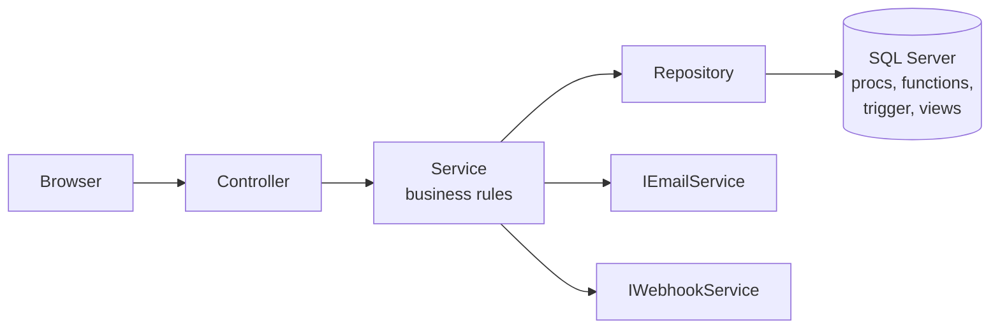
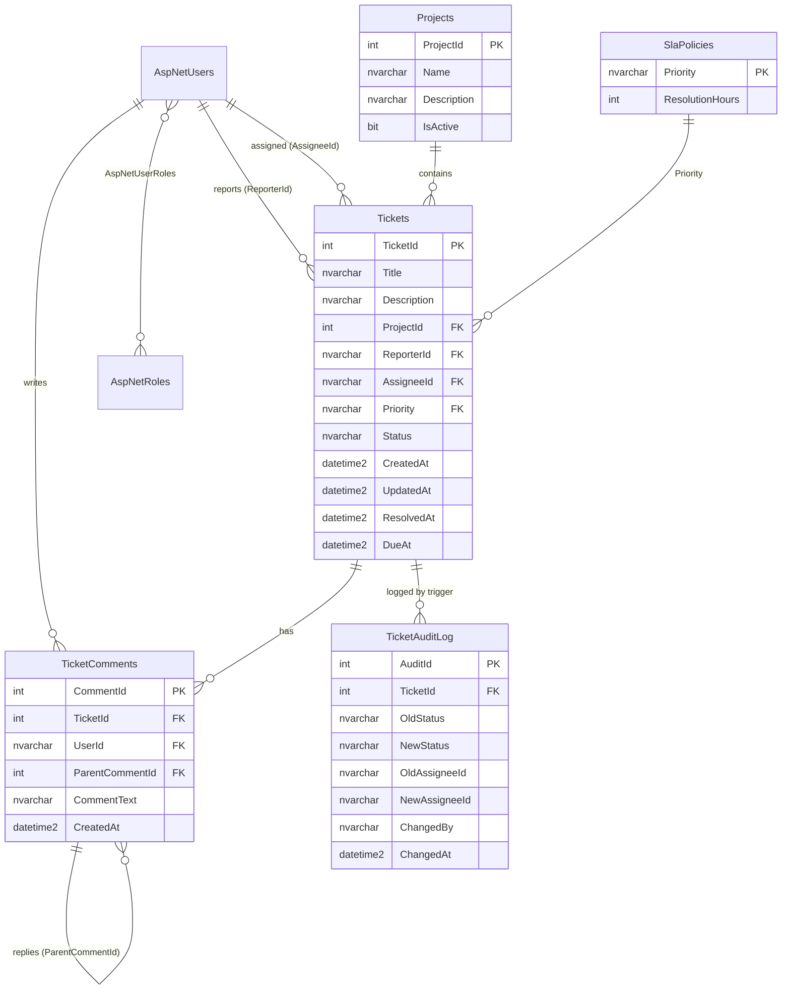

# TrackIt

An internal defect and issue tracker for a software team, like a small Jira. Reporters log defects, admins assign them, developers fix them, and admins close them. Data lives in **SQL Server**, and the workflow rules (status transitions, SLA due dates, audit history) live in **T-SQL** stored procedures, functions and a trigger. The web app is **ASP.NET Core MVC (.NET 8)**.

> **Build status:** the code was written without a .NET SDK or SQL Server available, so it has **not been compiled or run yet**. Expect to fix a few small compile errors or typos on first build. Run `dotnet build` and the SQL scripts first, and fix what they report.

## Features

| Role | Can do |
|---|---|
| **Reporter** | Log tickets (title, description, severity, project), view own tickets, comment |
| **Developer** | View assigned tickets, move them Open/Reopened → In Progress → Resolved, comment |
| **Admin** | Everything, plus assign, close and reopen tickets, manage users and projects, dashboard, weekly PDF report |

- Register and sign in with ASP.NET Core Identity; role-based authorization
- Ticket lifecycle: create, assign, change status, resolve, close, reopen
- Threaded comments (replies nest under their parent)
- Search and filter by status, priority, assignee, project and text, with server-side paging (`OFFSET/FETCH`)
- Dashboard: open vs closed, tickets by status and priority, SLA breaches, ticket aging, average resolution time per developer, monthly leaderboard
- Audit history written automatically by a trigger on every status or assignee change
- Email on assignment and closure (MailKit) and a Slack/Teams webhook when a Critical ticket is created
- Weekly defect summary exported to PDF (QuestPDF)

## Quick start

You need the .NET 8 SDK and SQL Server (a local install, or the Docker file below).

**1. Start SQL Server (optional, Docker)**

```bash
docker compose up -d
```

**2. Create the database**

From inside the `Database/` folder:

```bash
# Windows authentication
sqlcmd -S localhost -E -C -i run_all.sql

# SQL login / Docker (password from docker-compose.yml)
sqlcmd -S localhost,1433 -U sa -P "TrackIt_Dev#2026" -C -i run_all.sql
```

`run_all.sql` runs the numbered scripts in a safe order. To reset everything, run `DROP DATABASE TrackIt;` and run it again. (You can also open the scripts in SSMS and run them one by one.)

**3. Point the app at the database**

The default connection string in `TrackIt.Web/appsettings.json` uses Windows authentication on `localhost`. For the Docker database, set it without editing files:

```bash
export ConnectionStrings__TrackIt="Server=localhost,1433;Database=TrackIt;User Id=sa;Password=TrackIt_Dev#2026;TrustServerCertificate=True"
```

**4. Run**

```bash
dotnet run --project TrackIt.Web
```

In Development, the first start creates the three roles plus demo users, projects and tickets (`Seed:DemoData`). Sign in with the demo password `TrackIt#2026` (`Seed:DemoPassword`):

| Email | Role |
|---|---|
| `admin@trackit.local` | Admin |
| `dev1@trackit.local`, `dev2@trackit.local` | Developer |
| `reporter1@trackit.local`, `reporter2@trackit.local` | Reporter |

Demo data is never created outside Development, so change or remove these accounts before deploying anywhere real.

**5. Tests**

```bash
dotnet test
```

**Optional settings** (`appsettings.json` or environment variables): `Smtp:*` for email (leave `Smtp:Host` empty and messages are only logged), and `Webhook:Url` for a Slack or Teams incoming webhook (empty means disabled).

## Architecture

```
TrackIt/
├── TrackIt.Web/             ASP.NET Core MVC: controllers, views, startup, demo-data seeder
├── TrackIt.Core/            Entities, DTOs, interfaces, services (business rules), workflow rules
├── TrackIt.Infrastructure/  Dapper + EF Core repositories, Identity, SMTP, webhook, PDF
├── TrackIt.Tests/           xUnit tests for the service layer (hand-written fakes)
└── Database/                01_Tables ... 06_SeedData, run_all.sql
```



- **Controller → Service → Repository → SQL.** Controllers handle HTTP only. Services hold the rules. Repositories talk to the database. Everything is wired with dependency injection in `TrackIt.Infrastructure/DependencyInjection.cs`.
- **`TrackIt.Core` depends on nothing but interfaces.** The service layer never references SQL, EF, SMTP or HTTP, which is why it can be unit-tested with fakes.
- **Two data-access styles on purpose.** EF Core handles simple CRUD (projects, comments, Identity). Dapper calls the stored procedures for ticket workflows, dashboards and reports.
- **Tables come from SQL scripts, not EF migrations**, because the business logic lives in T-SQL.
- **Defence in depth.** Roles are checked in the service layer, and the status transition rules exist in two places (`TicketWorkflow` in C# and `usp_UpdateTicketStatus` in T-SQL). The database is the final authority.

## Database



| Object | What it does |
|---|---|
| `usp_CreateTicket` | Inserts the ticket and computes `DueAt` with `fn_GetSlaDueDate` |
| `usp_AssignTicket` | Checks the assignee is an active Developer, then updates (transaction + `TRY...CATCH`) |
| `usp_UpdateTicketStatus` | Validates allowed transitions, sets or clears `ResolvedAt` (transaction + `TRY...CATCH`) |
| `usp_GetTicketsFiltered` | Optional filters, `OFFSET/FETCH` paging, total count via `COUNT(*) OVER ()` |
| `usp_GetDashboardSummary` | Four result sets: by status, by priority, totals, aging |
| `usp_GetResolutionStatsByDeveloper` | `AVG(DATEDIFF(...))` per developer |
| `usp_GetWeeklyDefectSummary` | Feeds the weekly PDF report |
| `fn_GetSlaDueDate`, `fn_IsSlaBreached` | Scalar functions |
| `fn_GetOpenTicketsByAssignee` | Inline table-valued function |
| `trg_Tickets_AuditChanges` | `AFTER UPDATE`: compares `inserted` and `deleted`, logs Status/Assignee changes (multi-row safe) |
| `vw_OpenTicketAging` | CTE that buckets open tickets into 0-2, 3-7 and 8+ days |
| `vw_DeveloperMonthlyRank` | `RANK()` of developers by tickets closed this month |
| `vw_LatestCommentPerTicket` | `ROW_NUMBER()` to get the newest comment per ticket |
| `vw_TicketsOpenedPerDay` | Running total with `SUM() OVER (ORDER BY ...)` |

**Status rules** (enforced in both T-SQL and C#):

```
Open ──► In Progress ──► Resolved ──► Closed
  ▲            ▲             │           │
  └─ Reopened ─┴─────────────┴───────────┘   (Reopened ─► In Progress)
```

**How the trigger knows who made a change:** the procedures call `sp_set_session_context 'UserId'` before the `UPDATE`, and the trigger reads it with `SESSION_CONTEXT`.

`06_SeedData.sql` ends with a block of commented SSMS test queries you can run after the app has created the demo data.

## Interview notes

- **OOP.** Interfaces and abstraction (`ITicketRepository`, `IEmailService`), encapsulation (`TicketService` hides the rules behind `ITicketService`), dependency inversion (Core defines interfaces, Infrastructure implements them), the repository pattern, polymorphism (swap `SmtpEmailService` for a fake in tests).
- **Why Dapper for procedures but EF for CRUD?** Dapper is thin and maps stored-procedure result sets directly. EF is faster to write for plain entities.
- **Why a trigger for audit?** Anyone who changes the data, including a script run in SSMS, is logged, not just this app.
- **Why `THROW` numbers 50001-50006?** `TicketRepository` maps those SQL errors to `BusinessRuleException`/`NotFoundException`, so users see a clear message instead of a stack trace.
- **Notifications are best-effort.** A mail or Slack outage is logged and never rolls back a ticket change.

Write at least the stored procedures, the trigger and the window-function queries yourself from memory once. They are the likeliest on-paper interview questions.

## Resume notes

- Reports use **QuestPDF** (PDF report generation in code). Do **not** write SSRS or RDLC on a resume for this project, because none is used.
- Only list what you finish and can explain. If you skip the webhook or email, drop that line.

## Known limitations

- Not compiled or run in the environment it was written in (see the build status note above).
- Dashboard charts and Bootstrap load from a CDN, so the UI needs internet access.
- Client-side form validation scripts are not included. Validation is server-side only.
- No paging on the Users and Projects admin lists.
- Self-registration is open and always creates a Reporter. Turn it off for a real deployment.
